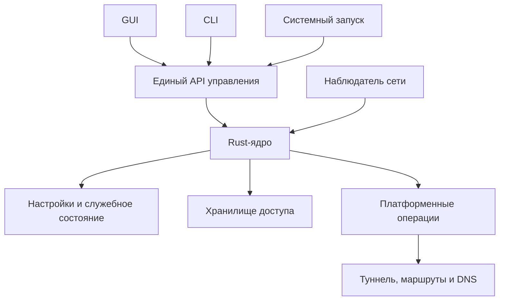

# Единые настройки, владение туннелем и восстановление соединения

Статус: реализация архитектуры, 2026-10-15. Основные этапы подключены к ядру и
клиентам; история реализации и ограничения проверок приведены ниже. Установка
на ноутбук, реальные переключения сетей и проверка Windows/Android на устройствах
в этот этап не входят. Примеры CLI соответствуют API настроек выбранного владельца.

## 1. Цели и границы

- Один активный конфиг настроек VPN для выбранной области исполнения.
- Одно Rust-ядро для GUI, CLI, фонового запуска и восстановления.
- Полноценный самостоятельный режим без systemd; одинаковый выбор владельца
  в GUI и CLI.
- Только один владелец сетевых ресурсов Floppa на машине.
- Ожидание отсутствующей сети без расходования попыток и смены протоколов.
- Режим «Авто» определяет разрешённые протоколы и их порядок для подключения
  и восстановления; дополнительного переключателя смены протокола нет.
- Реализация для Linux, Android и Windows. Apple сейчас не поддерживается:
  оставляем границы для будущего адаптера, но не добавляем фиктивную поддержку.
- Нет миграции старых пользовательских настроек, импорта их формата и
  совместимости со старыми RPC-клиентами. Протокольные ключи и существующие
  конфигурации доступа не удаляются.

Не входят в эту работу: новый kill switch, произвольное управление чужим VPN,
синхронизация настроек между устройствами, несколько одновременно работающих
туннелей Floppa и перенос на Apple. Корпоративный split DNS остаётся ответственностью
его OpenVPN-хука; новое ядро не должно его перезаписывать.

## 2. От чего отталкиваемся

Общее ядро уже есть: `TunnelActor` различает `Intent`, `Status` и наблюдаемый мир.
`TunnelControl` имеет локальную и удалённую реализации. Их расширяем, а не создаём
ещё один менеджер VPN.

Текущие расхождения, которые устраняем:

- GUI хранит настройки VPN в `localStorage`, сервис — копию последнего успешного
  запроса в `autostart.json`; CLI отдельно принимает файл маршрутов.
- Linux GUI умеет выбирать самостоятельный режим, обычный Linux CLI требует
  сервис; `--config` в CLI неявно выбирает самостоятельный запуск.
- Android сообщает ядру об отсутствии сети, Linux этого не делает.
- Исчерпание попыток может превратить временную потерю сети в окончательное
  отключение.
- Запись последнего успешного подключения организована разными путями в сервисе
  Linux и Android.
- Нормализация GUI возвращает отсутствующие протоколы в список, поэтому список
  приоритетов пока нельзя использовать как список разрешённых протоколов.

Старые документы описывают отдельные этапы реализации. При выполнении этого плана
обновить `DESKTOP-TUNNEL-SERVICE.md`, `ANDROID-TUNNEL-PROCESS.md`,
`ROUTE-EXCLUSIONS.md`, `ADB-CONTROL.md` и инструкции установки в части затронутого
поведения. Само наличие этого плана ещё не меняет описанное там текущее поведение.

## 3. Архитектурные границы



Ядро владеет моделью настроек, валидацией, планированием попыток, состоянием,
сохранением и применением изменений. Оно не знает systemd, пути Android или
расположение `%ProgramData%`. Эти зависимости передаются при создании экземпляра;
не добавлять новые глобальные переключатели хранения.

Платформенные адаптеры отвечают за запуск процесса, права, хранение секретов,
наблюдение за сетью, сетевые операции и системные запросы запуска/остановки.
GUI и CLI отображают состояние и отправляют команды. В них нет собственного
перебора протоколов, таймеров восстановления и второго планировщика.

| Размещение | Владелец ядра | Время жизни |
|---|---|---|
| Linux с сервисом | `floppa service` | Не зависит от GUI/CLI |
| Linux без сервиса | Самостоятельный GUI или CLI | До завершения владельца |
| Windows без сервиса | Самостоятельное приложение | До завершения владельца |
| Windows с будущим сервисом | Windows Service | Через тот же API; не обязателен для этого этапа |
| Android | Процесс `VpnService` | Управляется контрактом Android |
| Будущие Apple | Провайдер Network Extension | Отдельный будущий адаптер |

Сохранение интерфейса TUN не обещает сохранения TCP-сессий при смене транспорта.
Повторное использование TUN допускается там, где это поддерживает backend;
пересоздание выполняется через существующую логику отката.

## 4. Выбор владельца: одинаково для GUI и CLI

Выбор выполняется до изменения сети и сохраняется на время жизни клиента.

1. Проверить доступность системного endpoint управления, если платформа его
   поддерживает. Не использовать только наличие процесса или `systemctl is-active`:
   подключение к сокету может активировать сервис.
2. Доступный совместимый сервис — клиентский режим.
3. Отказ в доступе, несовместимая версия или неотвечающий сервис — явная ошибка.
   Не запускать локальное ядро в качестве обхода ошибки.
4. Сервис отсутствует — попытаться получить блокировку самостоятельного владельца.
5. Блокировка занята — явная ошибка. Не подключаться к самостоятельному владельцу
   для управления и не перехватывать его туннель.
6. Блокировка получена — восстановить остаточные сетевые изменения, открыть
   соответствующее хранилище и запустить локальное ядро.

Пример ошибки:

```text
Туннелем уже управляет самостоятельный GUI (PID 12345).
Отключите VPN и завершите владельца перед самостоятельным запуском.
```

PID/тип процесса — подсказка, а не основание решения. Если данные отсутствуют,
достаточно сообщения о занятом владении. Не показывать секреты или полную строку
запуска другого процесса.

Сервис не появился автоматически после ошибки самостоятельного запуска.
Смена режима производится новым запуском клиента после освобождения владельца;
живого переноса туннеля между процессами в этой работе нет.

### CLI и `--config`

Обычный `floppa connect` тоже выбирает локальный режим при отсутствии сервиса.
В локальном режиме команда остаётся в терминале, `Ctrl+C` отключает VPN и очищает
ресурсы. В сервисном режиме завершение клиентской команды не выключает VPN.

`--config` задаёт входную протокольную конфигурацию и не определяет владельца.
Его временные данные не должны автоматически перезаписывать `settings.json` или
постоянные ключи. Временный запрос существует до отключения/завершения владельца,
сохраняется в памяти для его переподключений, но не становится конфигурацией
автозапуска. При работе через сервис данные передаются ему через защищённый API.
Постоянное сохранение протокольных данных — отдельная явная операция; это не
импорт старого формата пользовательских настроек.

Универсальные временные переопределения всех полей настроек не добавляем.

## 5. Блокировка владения

### Linux

Общий для всех пользователей и сервиса объект:

```text
/run/floppa-vpn/tunnel.lock
```

Использовать неблокирующий эксклюзивный `flock`. Получение блокировки атомарно.
Открытый дескриптор удерживает сам владелец ядра до окончания очистки сети,
включая ожидание сети и переподключение. Он не должен случайно наследоваться
дочерними процессами. Блокировка не должна принадлежать краткоживущему помощнику,
который завершается сразу после привилегированной операции.

Сервис обязан брать ту же блокировку. Это закрывает гонку: самостоятельный GUI
уже работает, а сервис активировали позднее. Сервис сообщает `OwnerBusy`, не
трогает сеть и не превращает это в бесконечный цикл рестартов процесса.

Каталог и файл создаются установщиком или привилегированным помощником без
зависимости от systemd. Их нельзя подменить пользовательской ссылкой или удалить
и создать заново во время удержания блокировки. Права открытия блокировки не
должны означать право менять секреты или вызывать произвольные root-операции.
Разрешение на самостоятельную настройку сети по-прежнему проверяется помощником.

Не определять владение по существованию файла: после аварии файл может остаться,
но kernel lock освобождается. Диагностические метаданные хранятся отдельно от
блокируемого inode и не используются для принудительного убийства процесса.

### Windows и Android

На Windows — именованный mutex в общей машинной области, с явно заданными ACL.
Обработать abandoned mutex как возможную необходимость восстановления после
аварии. GUI и CLI используют одно имя независимо от пользовательской сессии.

На Android системная модель `VpnService` дополняется защитой от повторного
создания ядра в процессе. Это не desktop-файловая блокировка и не повод запускать
второе ядро в Activity. UI остаётся клиентом VPN-процесса.

### Восстановление после аварии

Свободная блокировка не доказывает чистоту сети. Сначала читается журнал отката,
потом очищаются принадлежащие Floppa остатки, затем начинается новое подключение.

На desktop блокировка и журнал сетевых операций должны иметь согласованную
область владения: новый root-сервис должен уметь безопасно восстановить изменения
прежнего самостоятельного владельца и наоборот. Не исполнять от root произвольный
журнал из пользовательского каталога. Для Linux использовать доверенное
машинное хранилище сетевого журнала и доступ к нему через привилегированный слой.
Владелец записывает только типизированные разрешённые операции, с проверкой
принадлежности ресурсов. Конфиг и ключи пользователя в этот журнал не попадают.
Если очистка не подтверждена, показать ошибку восстановления, а не создавать
поверх остатков новый туннель.

## 6. Один конфиг настроек

Конфиг изменяемый. Только текущий владелец хранилища записывает его через общую
реализацию Rust. GUI и CLI не содержат отдельных JSON-writer'ов.

| Область | Предлагаемый путь |
|---|---|
| Linux, системный сервис | `/var/lib/floppa-vpn/settings.json` |
| Linux, самостоятельный GUI/CLI | `$XDG_CONFIG_HOME/floppa-vpn/settings.json`, обычно `~/.config/floppa-vpn/settings.json` |
| Windows, самостоятельный режим | `%LOCALAPPDATA%\FloppaVPN\settings.json` |
| Windows, будущий системный сервис | `%ProgramData%\FloppaVPN\settings.json` |
| Android | `filesDir/settings.json` приложения |
| Apple в будущем | Путь, предоставленный адаптером приложения/провайдера |

Системная и пользовательская установки имеют разные области настроек. Это один
активный конфиг выбранной области, а не глобальный файл на все способы запуска.
Между областями нет автоматического объединения и синхронизации. API и команда
просмотра показывают выбранную область, владельца и путь.

При `sudo` не определять пользовательский путь случайно через изменившийся HOME.
Область должна быть определена явно до привилегированных операций; системные
секреты не копируются в пользовательское хранилище и наоборот.

### Предлагаемая схема

```json
{
  "schema_version": 1,
  "revision": 1,
  "protocols": {
    "mode": "auto",
    "auto_order": ["amneziawg", "vless"],
    "manual": "amneziawg"
  },
  "routing": {
    "allow_lan": false,
    "excluded_routes": ["194.186.63.0/24"],
    "apps": {"mode": "all", "items": []}
  },
  "recovery": {"mode": "persistent"},
  "startup": {"connect_on_boot": false}
}
```

Альтернатива для ограниченного восстановления:

```json
{"recovery": {"mode": "limited", "rounds": 3}}
```

- Порядок `auto_order` одновременно задаёт разрешённый набор; второй список
  `enabled_protocols` не нужен.
- Ручной выбор сохраняется отдельно как предпочтение неактивного режима.
- Не добавлять отсутствующие протоколы при нормализации или обновлении приложения.
- В режиме Auto список непустой и без дубликатов. Ручной выбор допустим только
  среди известных протоколов.
- Отсутствующая конфигурация разрешённого протокола отображается отдельно и не
  удаляет его из пользовательских настроек. Если нет ни одного применимого
  протокола, вернуть явную ошибку.
- Маршруты, выданные сервером по подписке, не выдаются за пользовательские
  предпочтения: они входят в вычисленный план вместе с конфигурацией доступа.
- Возможности платформы валидируются в ядре. Неподдерживаемые настройки не
  игнорируются молча. Например, поддержка разделения по приложениям и исключения
  адресов должна быть объявлена отдельно и подтверждена реализацией адаптера.
- `connect_on_boot` — предпочтение приложения там, где оно может управлять
  запуском. Android Always-on/lockdown — отдельное наблюдаемое состояние ОС,
  не зеркальная копия этого boolean. Неподдерживаемую операцию CLI отклоняет.

### Что не является конфигом

Отдельно остаются:

1. Секреты и конфигурации протоколов в выбранном для размещения защищённом
   хранилище. Linux boot-service не зависит от пользовательского keyring.
2. Небольшое служебное состояние: последнее намерение, контекст загрузки/сессии,
   последний успешный протокол. Здесь нет копии routing и списка протоколов.
3. Журнал отката сетевых операций.
4. Настройки интерфейса пользователя: тема, окно, отображение подробностей.

Живые таймеры и `Connected` не восстанавливаются с диска как достоверные факты.
После старта ядро заново наблюдает систему. Успешный протокол — подсказка,
а не право обойти список разрешённых протоколов.

## 7. Изменение настроек

Общий API расширяет существующий `TunnelControl`:

```text
get_settings -> settings + revision + scope + capabilities
update_settings(expected_revision, changes) -> accepted revision
connect -> accepted operation
disconnect -> accepted operation
watch_state -> состояние подключения и результат применения настроек
```

Пример предлагаемого CLI:

```sh
floppa settings show
floppa settings set protocols.mode auto
floppa settings set protocols.auto_order '["amneziawg","vless"]'
floppa settings set recovery.mode persistent
floppa autostart on
```

`autostart on/off` остаётся удобным интерфейсом к `startup.connect_on_boot`;
отдельный `resume-on-boot` больше не используется.

Последовательность записи:

1. Проверить expected revision, схему, значения и возможности платформы.
2. Атомарно записать новую версию; обеспечить необходимые гарантии flush/rename
   на конкретной ОС. Не подтверждать успешное сохранение до завершения записи.
3. Опубликовать новую ревизию всем клиентам.
4. Вычислить необходимые сетевые действия и применить их через actor.
5. Опубликовать успешное применение либо ошибку с сохранённой ревизией.

Сохранённая конфигурация и фактически применённая ревизия видны отдельно.
Не откатывать файл молча при сетевой ошибке. Изменение, которое требует
переподключения, проходит через существующий сериализованный механизм actor.
При новом `connect` используется новая ревизия; активный план — снимок в памяти,
а не второй постоянный конфиг.

Во время самостоятельной работы второй GUI/CLI не меняет файл: он получает
`OwnerBusy`. Канал удалённого управления самостоятельным владельцем не создаём.
Если владельца нет, короткая команда изменения настроек получает ту же блокировку,
меняет файл через общее Rust-хранилище и освобождает её без поднятия туннеля.
В сервисном режиме параллельная работа GUI и CLI штатна; конфликты правок
разрешаются через ревизии. Прямую правку файла при работающем владельце и live
file-watching в первом этапе не поддерживаем.

## 8. Единый выбор протоколов

Чистая функция строит план из настроек, причины подключения, доступных
конфигураций и подсказки о последнем успехе.

| Причина | Порядок |
|---|---|
| Новая команда подключения | Пользовательский порядок Auto или один ручной протокол |
| Восстановление ранее работающего подключения | Последний успешный, если разрешён, затем остальные в пользовательском порядке |
| Возвращение сети | Сначала восстановить текущий транспорт; при необходимости использовать план восстановления |
| Изменение разрешённого набора | Никогда не использовать исключённый протокол |

Победитель не переписывает `auto_order`. После успешного fallback не переключаться
назад только потому, что более приоритетный протокол снова может стать доступным.
Отдельного разрешения смены протокола нет; разрешение уже выражено режимом и списком.

## 9. Сеть и восстановление

### Модель сети

Платформенный наблюдатель сообщает начальный снимок и последующие изменения:

- `Unavailable`: нет пригодного пути для транспорта.
- `Available`: есть потенциальный путь; это не гарантия доступа к интернету.
- `Unknown`: достоверного наблюдения пока нет.

Снимок включает поколение сети и сведения, нужные платформенному адаптеру для
обновления транспорта. Не считать собственный VPN или виртуальный адаптер
доказательством внешней связности. Не ограничиваться Ethernet/Wi-Fi: USB tethering,
мобильная сеть и другие пригодные пути тоже должны работать.

Linux: наблюдение link/address/route через netlink проверяет только наличие
пригодного внешнего пути. Маршрут для помеченного транспортного сокета выбирает
ядро; приложение не закрепляет endpoint за интерфейсом или шлюзом. Не требовать
NetworkManager или systemd-networkd. Windows: системные уведомления об интерфейсах,
адресах и маршрутах. Android: существующие callbacks `ConnectivityManager` для
underlying network и обновление привязки транспорта.

События пробуждают actor, а не запускают второй reconnect loop. Редкая повторная
сверка восстанавливает наблюдение после потери событий. `Unknown` не приравнивается
ни к доказанному Offline, ни к доказанному доступному интернету. Ошибка платформы
«нет пути» типизируется и инициирует перепроверку, а не распознаётся по тексту.

Проверка публичного сайта не является обязательным условием попытки VPN:
его блокировка и captive portal не доказывают отсутствие подходящего пути.

### Правила

- Пользовательское намерение Up сохраняется при временной сетевой ошибке.
- При отсутствии сети состояние интерфейса — «Ожидание сети». Не показывать
  успешный Connected и не считать это ручным отключением.
- Ожидание не расходует число проходов/протоколов; результаты попыток, прерванных
  сменой поколения сети, не расходуют новый бюджет.
- При появлении пути проверить туннель. Linux использует маркированные сокеты
  и текущие маршруты ядра; Windows обновляет endpoint route, Android — socket
  binding. Сохранить живой TUN, где это возможно; иначе корректно пересоздать его.
- На смене сети сбросить устаревший таймер молчания peer, дать свежую возможность
  восстановить обмен. Длительный suspend не должен мгновенно исчерпать таймеры.
- При доказанно доступном пути и временной ошибке сервера выполнять общий план
  протоколов с ограниченными таймаутами и backoff с jitter.
- Persistent — повторять до ручного отключения; Limited — заданное число полных
  проходов. В Limited после исчерпания показать Failed без фонового перебора;
  намерение и причина не маскируются под ручной Disconnect. Новая команда Retry
  запускает новый бюджет. Отсутствующая сеть не исчерпывает этот бюджет.
- Постоянные ошибки настроек/доступа/разрешения переводят в NeedsAttention;
  persistent не означает бесконечные запросы пароля или повтор неверного ключа.
- Отмена имеет приоритет: устаревший ответ попытки, DNS или rebind не может снова
  поднять соединение после Disconnect. Проверять поколение операции и сети.
- CLI ожидание результата имеет отдельную семантику от времени жизни запроса:
  таймаут ожидания ответа сервиса сам по себе не отключает VPN.

Приоритетная последовательность состояния:

```text
Disconnected --Connect--> WaitingForNetwork или Connecting
Connecting --успех--> Connected
Connected --нет сети--> WaitingForNetwork
WaitingForNetwork --путь появился--> восстановление / Connecting
Connecting --временная ошибка--> Backoff --> Connecting
Connecting --постоянная ошибка--> NeedsAttention
любое активное состояние --Disconnect--> остановка и очистка --> Disconnected
```

Это пользовательские состояния. Реализация может сохранить существующие
внутренние состояния actor и добавить необходимые причины/данные, не создавать
параллельный автомат.

Гарантия «намерение подключиться сохраняется» не является kill switch. Во время
восстановления прямой трафик зависит от отдельной политики и возможностей ОС.
Новые обещания блокировки трафика в этой работе не добавляются.

## 10. Запуск, завершение и автоподключение

- Рестарт внешнего владельца после аварии в той же загрузке восстанавливает
  сохранённое намерение только после очистки/наблюдения сетевого состояния.
- Ручной Disconnect сначала надёжно фиксирует Down, затем отменяет попытки и
  очищает сеть. Успех команды означает подтверждённое завершение; ошибка очистки
  остаётся видна и в журнале.
- Штатный выход самостоятельного владельца завершает VPN. Закрытие окна в трей
  не равно завершению процесса; это определяется отдельной настройкой GUI.
- Системный shutdown не выдаётся за ручное отключение пользователя.
- При новой загрузке действует connect_on_boot, а не устаревшее намерение прошлой
  загрузки. Контекст загрузки/причину старта предоставляет платформа.
- Самостоятельный режим не обещает рестарт после смерти процесса без внешнего
  механизма запуска. Общий алгоритм умеет восстановиться, когда процесс запущен.
- Android Always-on start и revoke обрабатываются явно. Отзыв разрешения не
  обходится автоматическим повтором. UI не присваивает себе управление системным
  Always-on/lockdown.
- Системный launcher запускает ядро; ожидание интернета и перебор протоколов
  принадлежат ядру. systemd может рестартовать упавший процесс, но не заменяет
  политику восстановления туннеля.

Сохранение настроек и намерения сериализуется одним владельцем. Для нескольких
файлов не предполагать общую атомарность: использовать ревизии и определённый
порядок записи. Подтверждённое изменение должно пережить аварийный рестарт;
расхождение ревизий обнаруживается, а не заменяется молча старыми параметрами.

## 11. Отказ от старых форматов

Никаких миграций или выбора между старыми настройками GUI и сервиса.
Новый код не использует старые `autostart.json`, `resume-on-boot`, routing JSON и
VPN-поля localStorage как источник настроек.

На личном ноутбуке новый конфиг настраивается один раз явно, включая
`194.186.63.0/24`. Старые пользовательские настройки можно сохранить резервной
копией при установке, но приложение не читает их автоматически.
Ключи, данные доступа, необходимые для действующего туннеля, и аварийный сетевой
журнал не удаляются вместе с устаревшими настройками. Нельзя стирать весь каталог
состояния ради чистого перехода.

Версию RPC повысить; старый клиент получает понятную ошибку несовместимости и
не уходит в самостоятельный режим. Не добавлять адаптеры старого API ради
совместимости, которая сейчас не нужна.

## 12. Карта реализации

Имена новых модулей уточняются при реализации; границы ответственности фиксированы.

| Область кода | Изменение |
|---|---|
| `floppa-vpn-core/src/settings/` (новый модуль) | Модель, проверка, ревизии, атомарное сохранение без платформенных путей |
| `floppa-vpn-core/src/actor/` | Settings API, вычисленный план, намерение, ожидание сети, классификация ошибок |
| `floppa-vpn-core/src/client_mode.rs` | Общий выбор сервисного/самостоятельного режима |
| Новый модуль ownership + платформенные реализации | Guard, типизированный OwnerBusy, безопасные метаданные |
| `floppa-vpn-core/src/platform/` | События сети, обновление транспорта/endpoint route, capabilities |
| `floppa-vpn-core/src/rpc*.rs`, `remote.rs` | Один контракт настроек/состояния/ошибок для клиентов |
| `floppa-vpn-core/src/autostart.rs` | Убрать копию настроек; оставить необходимые понятия системного старта/служебного состояния |
| `floppa/src/main.rs`, `client.rs`, `connect.rs`, `service.rs` | Одинаковый выбор владельца, settings CLI, явная семантика временного конфига |
| `floppa-client/src/stores/settingsStore.ts`, `vpnStore.ts` | VPN-настройки через ядро; локально только UI и несохранённый черновик |
| `ProtocolPriorityList.vue`, `utils/protocolOrder.ts` | Разрешённый набор, приоритет, отсутствие автоматического добавления протоколов |
| Tauri bootstrap/owner, Android JNI и Kotlin | Одинаковая сборка зависимостей ядра, ОС-события и жизненный цикл |
| Установщики, Linux helper, systemd units | Общая блокировка/журнал, права, запуск без дублирования reconnect |

Не вводить новый crate только ради каждого trait. Сначала локальные модули
существующего ядра; вынос оправдан только независимым использованием.

## 13. Порядок выполнения

1. Зафиксировать типы настроек, capabilities, причины запуска и инварианты.
   Добавить хранилище и тесты сохранения/ошибок/ревизий.
2. Реализовать владение и общий выбор режима. Покрыть GUI, CLI, сервис,
   отсутствие systemd, гонки запуска и восстановление журнала.
3. Подключить единый API и GUI/CLI. Сменить RPC, убрать старые источники настроек,
   реализовать отдельную временную конфигурацию без влияния на автозапуск.
4. Добавить разрешённые протоколы и чистый планировщик. Подключение, восстановление
   и boot-start используют его; локального перебора в UI нет.
5. Добавить наблюдение сети и политику восстановления на Linux/Windows; привести
   существующий Android-путь к тем же контрактам. Сохранить независимость от UI.
6. Уточнить lifecycle, системный старт, Disconnect и восстановление после аварии;
   убрать конкурирующие внешние retry loops.
7. Проверить приложения и packaging, обновить документацию, собрать артефакты.
8. Отдельным заключительным действием установить сборку на ноутбук и записать
   новый пользовательский конфиг. До этого не заменять работающий VPN.

Каждый этап — небольшой проверенный логический шаг. Не считать успешную сборку
подтверждением поведения Windows или Android на реальном устройстве.

## 14. Приёмочные проверки

### Хранение и интерфейсы

- GUI меняет настройку: запись подтверждена, CLI читает то же значение.
- CLI меняет настройку через сервис: открытый GUI получает новую ревизию.
- Конкурирующие изменения со старой ревизией отклоняются, данные не теряются.
- Ошибка записи/некорректный JSON/неподдерживаемая версия не приводят к молчаливой
  перезаписи дефолтами. Секреты отсутствуют в settings show и диагностике.
- Перезапуск владельца и boot-start читают тот же конфиг без GUI.
- Старые файлы настроек не влияют на результат; ключи остаются доступны.
- Временный `--config` не меняет постоянные настройки и секреты.

### Владение

- GUI и CLI одновременно без сервиса: только один получает владение.
- Второй самостоятельный клиент, включая settings-команду, получает OwnerBusy.
- Работающий сервис: оба клиента используют его и не берут локальное владение.
- Permission denied/несовместимая версия/timeout сервиса не вызывают fallback.
- Сервис запущен после самостоятельного владельца: сеть не меняется.
- Убийство владельца освобождает OS lock; новый владелец восстанавливает журнал.
- Проверки между разными пользователями и с повышением привилегий.
- Остаточный lock-файл и устаревший PID не считаются живым владельцем.

### Восстановление

- Холодный запуск без сети и сети нет дольше прежнего лимита: ожидание,
  автоматическое подключение после появления пути.
- Пропадание сети у работающего VPN: нет перебора протоколов и исчерпания бюджета.
- Ethernet ↔ Wi-Fi ↔ USB tethering: endpoint не остаётся на исчезнувшем интерфейсе.
- Android: авиарежим, Wi-Fi ↔ мобильная сеть, сон, закрытый/остановленный UI,
  системный старт и revoke. Запись logcat — отдельной живой сессией.
- Windows: смена адаптера, suspend/resume, отсутствие default route.
- Сеть есть, сервер недоступен: fallback только по разрешённому списку,
  persistent/limited ведут себя по описанным правилам.
- Сеть исчезла во время handshake/backoff/последней попытки: старый результат
  не расходует новый бюджет и не отменяет ожидание.
- Disconnect во время ожидания/rebind: возвращение сети не включает VPN.
- Новый протокол после обновления не становится разрешённым автоматически.
- Два VPN: Jira через корпоративный DNS, обычные домены через Floppa при его
  работе, endpoint корпоративного VPN остаётся исключённым из Floppa.

Тесты чистого автомата и хранилища выполняются на host; сетевые сценарии сначала
в изолированном окружении. Затем ручная проверка на Linux, Android и Windows.
Для платформы без доступного устройства явно фиксируется непроверенная часть.

## 15. Ход реализации

Первый этап, 2026-10-14:

- Добавлен `floppa-vpn-core/src/settings/`: типы, capabilities, строгая проверка,
  ревизии, атомарное файловое хранилище и чистая функция построения плана протоколов.
- Старые пользовательские настройки новый модуль не читает; ошибочный файл
  не перезаписывается дефолтами. Запись и пути ещё не подключены к живому actor.
- CLI сообщает выбранный режим при обращении к сервису и при самостоятельном
  запуске туннеля; сообщения идут в stderr, не меняя машинный вывод stdout.
- Главная карточка GUI показывает режим только на Linux: systemd service,
  standalone или недоступный выбранный сервис. Другие платформы этот компонент
  не создают.
- Это не переключение работающего приложения на новый конфиг: подключение
  Settings API к actor/RPC/GUI/CLI, блокировка владельца, унификация выбора режима
  и новое восстановление ещё предстоят. Установка на ноутбук не выполнялась.

Второй этап, 2026-10-14 — подключение к владельцу туннеля:

- `TunnelActor::spawn` сначала получает OS-блокировку, затем загружает и валидирует
  `settings.json`. Ошибка файла останавливает запуск; дефолты создаются только при
  его отсутствии. Установленные приложения и настройки ноутбука не изменялись.
- Linux service использует `/var/lib/floppa-vpn/settings.json`; standalone GUI/CLI —
  `$XDG_CONFIG_HOME/floppa-vpn/settings.json` (обычно
  `~/.config/floppa-vpn/settings.json`). Windows —
  `%LOCALAPPDATA%/FloppaVPN/settings.json`, Android — приватный каталог приложения.
  Старые пользовательские настройки не импортируются.
- Settings API проходит через `TunnelHandle` и RPC: `get_settings`,
  `update_settings(expected_revision, settings)`. Владелец сериализует запись;
  устаревшая ревизия отклоняется. `intent_revision` обозначает настройки принятого
  запроса на подключение, а не подтверждение успешного применения к сети.
- GUI сохраняет VPN-настройки через владельца; в localStorage остаются только
  настройки интерфейса. Перед Connect очередь сохранений завершается. Конфликт
  останавливает запись и требует перечитать документ. Linux GUI перечитывает
  настройки при возвращении фокуса; подписки на изменения Settings API пока нет.
- Linux CLI: `floppa settings show` и `floppa settings set <поле> <значение>`.
  Например: `floppa settings set recovery '{"mode":"limited","rounds":3}'`.
  `autostart on/off` меняет `startup.connect_on_boot` через тот же API.
- Linux CLI и GUI используют доступный сервис; только отсутствие сервиса
  разрешает standalone. Недоступный/несовместимый сервис не вызывает fallback.
  Standalone Connect остаётся в foreground до остановки; Ctrl+C работает и во
  время ожидания сети. Режим сообщается в stderr CLI и в Linux-компоненте GUI.
- `connect --config` передаёт временный профиль выбранному владельцу. Он не
  импортируется в хранилище ключей и не записывается как профиль автозапуска.
- Linux использует общий root-owned `/run/floppa-vpn/tunnel.lock`, Windows —
  глобальный именованный mutex на отдельном OS-потоке, Android — app-private
  файловую блокировку. Блокировка удерживается во время ожидания сети, попыток и
  отката. Освобождение не удаляет файл; смерть процесса освобождает OS-блокировку.
- Подключение строит список из настроек и доступных профилей. Ручной режим не
  переключает протокол. При восстановлении последний успешный протокол
  перемещается вперёд только внутри текущего намерения; сохранённый порядок
  пользователя не меняется. Новые протоколы не дописываются в allowlist.
- Начальное подключение и восстановление используют одну политику:
  `persistent` по умолчанию либо `limited` с числом полных кругов. Ожидание сети
  сохраняет курсор и бюджет; потеря сети во время попытки отменяет и очищает её.
  Живой TUN при Offline сохраняется, но UI показывает ожидание сети. Disconnect
  отменяет намерение, поэтому возврат сети не подключает VPN заново.
- Проверка удалённого серверного peer получает ошибки незавершённого цикла, поэтому
  работает и при persistent recovery. Проверки ограничены одной на протокол за
  30 секунд; уже пересозданный peer не пересоздаётся повторно в том же цикле.
  Временный профиль не участвует в этой автоматической проверке.
- Linux слушает rtnetlink и перепроверяет снимок каждые 30 секунд (при отсутствии
  подписки — каждые 2 секунды). Снимок проверяет наличие default route через
  работающий интерфейс и исключает известные типы туннелей. Метрики, смена адреса
  и интерфейса не вызывают teardown. Выбор маршрута выполняет Linux. Это наблюдение
  доступности пути, не HTTP-проверка Интернета.
- Windows пока опрашивает физические адаптеры и default routes через PowerShell;
  Android сохраняет существующие ConnectivityManager callbacks и socket rebind.
  Ошибка наблюдения означает Unknown, а не Offline.
- `runtime.json` заменяет старый autostart bundle без миграции: только последний
  успешный протокол, серверные private routes и время. Пользовательские routing,
  protocol, recovery и startup-настройки в него не копируются. Секреты и журнал
  отката по-прежнему хранятся отдельно от пользовательского конфига.

Проверки этого этапа: unit/integration-тесты ядра и CLI с fake backend, отдельный
процесс для проверки освобождения lease после kill, тесты GUI-хранилища, TypeScript,
сборка frontend, Clippy, cross-check ядра Windows и Tauri-библиотеки Android.
Реальные туннели, полётный режим, перезагрузка и Windows mutex между разными
пользователями не проверялись; сборка не заменяет эти приёмочные сценарии.

Оставшиеся на этом этапе пункты реализованы в следующем разделе завершения.
Реальная приёмка на поддерживаемых устройствах остаётся отдельной проверкой.


### Linux: обязательная маркировка транспорта

Каждый внешний TCP/UDP-сокет WG/AWG/VLESS получает `SO_MARK=0x666c6f70` до
первого пакета. Gotatun сохраняет mark при rebind; shoes-lite передаёт его через
`VlessConfig` в connector, включая ping и новые соединения. Ошибка установки
метки закрывает сокет; запуск без метки и переключение на другую схему исключены.
Предварительная проверка выполняется до изменения сети, но не заменяет проверку
каждого созданного сокета. Ошибка прав прекращает цикл с пояснением о capabilities.

Маршруты Floppa устанавливаются в отдельную таблицу `1718382448`, после применения
исключений из конфигурации. Правило `31000` для немаркированного трафика сначала
проверяет более специфичные маршруты `main` (`suppress_prefixlength 0`): локальную
сеть и корпоративные подсети. Правило `31010` затем проверяет таблицу Floppa.
Исключённые сети отсутствуют в ней и попадают под последующие системные правила.
Маркированный транспорт пропускает оба правила, следует системной маршрутизации
и не нуждается в endpoint host route. При смене Ethernet/Wi-Fi/USB путь выбирается
ядром, включая метрики. Уже установленный TCP-сеанс при смене исходного IP может
оборваться; его восстановление остаётся задачей транспорта/общего recovery.

Таблица nftables `inet floppa_policy` сохраняет mark исходящего соединения в
conntrack и восстанавливает его у ответов. Вместе с `src_valid_mark=1` это позволяет
строгому IPv4 `rp_filter` проверить ответ по внешнему маршруту. Исходное значение
sysctl и семейства правил записываются в rollback journal до применения. Откат
удаляет только собственные правила и таблицу, восстанавливает sysctl. До старта
проверяется, что зарезервированные номера и таблицы свободны; чужие записи не
перезаписываются. Существующая блокировка владельца остаётся обязательной.

AppImage больше не собирается и не предлагается для скачивания. Linux поставляется
нативными пакетами. Arch `.install` и deb post-install назначают `cap_net_admin+ep`
на GUI и CLI после установки/обновления. В standalone сокеты создаёт сам GUI/CLI,
в режиме сервиса — сервис. Проверка основана на успехе `SO_MARK`, а не разборе
`/proc/self/status`. Новый привилегированный процесс не добавляется: существующий
network helper продолжает настраивать маршруты, nftables и DNS. Зависимости Linux:
`iproute2`, `nftables`, `procps`/`procps-ng` и `libcap`/`libcap2-bin`.

Проверка сетевой схемы без изменения сети хоста:

```sh
sudo -n unshare --mount --net uv run --no-project python scripts/tests/linux-policy-routing.py
```

Тест проверяет IPv4/IPv6, исключения, корпоративные маршруты, реальные помеченные
TCP/UDP-запросы и ответы при strict rp_filter, смену default route и очистку.
Он не заменяет проверку настоящего VPN и GUI после установки пакета.

### Надёжность журнала восстановления

Запись отката обязательна до изменения сети. Ошибка чтения или сохранения журнала
прерывает попытку без перехода к следующему протоколу. Повреждённый журнал остаётся
на месте: переименование с последующей трактовкой отсутствующего файла как пустого
больше не допускается. Ошибка при запуске возвращается владельцу; после ошибки
восстановления аварийной попытки новые подключения блокируются до исправления
журнала и перезапуска процесса. Команда отключения остаётся доступной.

Неудавшийся откат сохраняет шаги и в памяти, и на диске. Повторный вызов очистки
не может стереть их как якобы пустой стек. Ошибка очистки журнала не считается
успешным восстановлением. На Unix атомарная запись включает fsync каталога после
rename, удаление журнала также синхронизирует каталог.

### Linux: общий доверенный откат

Сервис и standalone используют `/var/lib/floppa-vpn/network-rollback-v1/`, принадлежащий
root с правами 0700. Существующий network helper сам захватывает исходное состояние
перед изменением сети и сохраняет фиксированные типы записей: link, routes, policy,
dns. Новый привилегированный процесс или служба не добавлены. Внутри helper операции
сериализуются через flock; запись синхронизируется до применения операции. Оригинал
resolv.conf, цель ссылки и значение sysctl не принимаются от вызывающего процесса.
Для настройки DNS клиент передаёт только адреса серверов, без временного файла.

После получения общей блокировки владельца ядро вызывает восстановление через
адаптер платформы. Пользовательские rollback.json на Linux больше не читаются;
миграции старых журналов нет. Восстановление также выполняется после аварии задачи
подключения и перед следующей попыткой. Записи удаляются только после успешного
отката. Обычный disconnect использует те же функции восстановления отдельных шагов.
Реальные пользовательские настройки и ключи остаются в прежних хранилищах.

Журнал записывает идентификатор загрузки системы. После перезагрузки старые
kernel-маршруты, sysctl и TUN не восстанавливаются поверх новой сети. Изменение
resolv.conf переживает перезагрузку, поэтому его исходный файл/ссылка/отсутствие
восстанавливаются независимо от boot ID. При очистке записанный persistent TUN
удаляется, что позволяет следующему владельцу создать его для другого UID.

Защита основана на root-only каталоге и разрешении существующего polkit helper:
это не защита от root или пользователя, которому уже разрешено менять сеть через
helper. Нет интерфейса загрузки произвольных команд или пользовательского журнала.
На этом промежуточном этапе Windows использовал журнал владельца, Android — прежнюю
модель VpnService. Долговечное намерение добавлено следующим этапом, описанным ниже.

Проверки выполняются без изменения сети и файловой системы хоста:

```sh
sudo -n unshare --mount --net uv run --no-project python scripts/tests/linux-shared-recovery.py
sudo -n unshare --mount --net uv run --no-project python scripts/tests/linux-policy-routing.py
```

Проверяются передача TUN между UID, восстановление файла/ссылки/отсутствующего DNS,
частичное применение маршрутов, отказы записи и отката, сохранение повреждённой
записи и поведение после смены boot ID. Тесты монтируют отдельные /var/lib и /etc,
а также sysfs текущего network namespace. Живое подключение через systemd-resolved
и настоящий VPN после установки пакета ещё требуют приёмочной проверки.

### Завершение общего ядра и платформенных адаптеров, 2026-10-15

- `runtime.json` v4 содержит `desired_up`, `boot_id`, последний успешный протокол,
  серверные private routes и время записи. Это служебное состояние, не второй
  конфиг. Миграции нет. Повреждённый текущий runtime блокирует запуск, а не
  перезаписывается. Старые версии не импортируются.
- Единственный serial writer принадлежит ядру. Принятие постоянного Configure/Down
  ожидает durable-записи на отдельном дисковом потоке; сетевые операции не выполняются
  в обработчике команды. Последний успешный протокол записывается тем же writer,
  поэтому поздний результат подключения не может воскресить отменённое намерение.
  Временный профиль не сохраняется и не восстанавливается после смерти процесса.
- Linux использует kernel boot ID, Android передаёт BOOT_COUNT через JNI, Windows
  читает системный LastBootUpTime через CIM. При неизвестной загрузке автоматического
  восстановления нет; Windows также отказывается открывать сетевой журнал без
  идентификатора загрузки. Обычные ручные запросы Linux/Android остаются доступны.
- В той же загрузке длинноживущий владелец восстанавливает desired Up; в новой
  загрузке действует `startup.connect_on_boot` там, где платформа поддерживает
  boot start. Standalone сам себя не запускает. Короткие CLI-запросы создают владельца
  с `resume_on_start=false`, чтобы чтение настроек не поднимало VPN.
- `Suspend` используется при остановке сервиса: сеть очищается, желание пользователя
  сохраняется. Явный Down и выход standalone фиксируют отключение. Android Always-on
  остаётся системным запросом и не выключается флагом приложения; boot job допускает
  собственный boot-флаг либо подтверждённый системный запуск в текущей загрузке.
- Изменение routing/protocol/recovery активного постоянного подключения передаётся
  существующему actor. Startup-настройка не пересоздаёт туннель. Недоступный выбранный
  протокол отключает старое соединение и публикует ошибку; файл не откатывается.
- Подписка на TunnelState передаёт `settings_revision`, `applied_revision` и
  `settings_apply_error`. Применённая ревизия подтверждается подключением. GUI
  перечитывает документ по событию новой ревизии, ожидая свои незавершённые записи;
  конфликт не затирается автоматическим перечитыванием. CLI status показывает обе
  ревизии и ошибку применения.
- Публичные `failed` и `needs_attention` различают исчерпание подключения и проблему
  отката. Они отображаются в GUI, трее и Android terminal-phase обработчике.
  Jitter задержки находится между половиной и полной экспоненциальной задержкой,
  с прежним верхним пределом; pure reconcile получает seed из политики владельца.
- Windows подписывается на IP Helper route/interface/address notifications. Снимок
  по-прежнему читается через системные Get-Net* команды, с резервным опросом раз
  в 30 секунд (2 секунды без подписки). Linux сохраняет rtnetlink без выбора
  интерфейса для маршрутизации; Android — ConnectivityManager.
- Windows GUI и CLI используют один каталог `%LOCALAPPDATA%/FloppaVPN` для
  настроек и состояния. CLI использует общий standalone actor и ту же блокировку;
  Unix-права и обработчики сигналов отделены платформенными условиями. Миграции
  прежних каталогов нет. Индикатор service/standalone в GUI остаётся только на Linux.
- Windows использует `%ProgramData%/FloppaVPN-Recovery-v1/rollback.json` под общей
  блокировкой владельца. Каталог создаётся с защищённой ACL только Administrators
  и SYSTEM, проверяется владелец/ACL/reparse point. Пользовательские журналы не
  читаются с повышенными правами. Маршруты устанавливаются в ActiveStore, записи
  прошлой загрузки для них не проигрываются. Откат проверяет принадлежность индекса
  интерфейсу и подтверждает удаление маршрутов. Это граница от непривилегированных
  пользователей, не от администратора машины.

Автоматические проверки охватывают настройки живого fake-туннеля, ошибки применения,
последовательность durable Up/Down/Suspend и winner, ошибки записи, смену boot ID,
jitter, ревизии GUI, unit-тесты ядра и кросс-компиляцию платформ. Они не заменяют
ручную приёмку: Windows ACL между учётными записями/UAC, Android boot/Always-on/отзыв
разрешения и реальные VPN при переключении сетей ещё нужно проверить на устройствах.
Установленный VPN во время разработки не изменялся.
